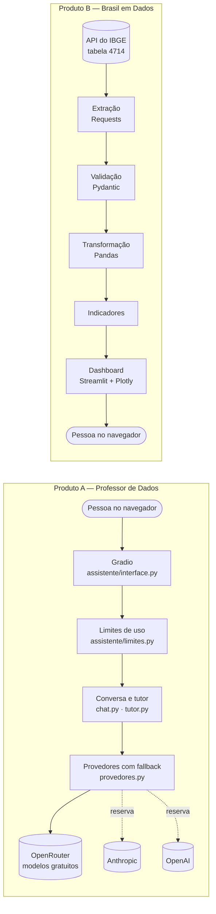

# Arquitetura e estrutura de pastas

## Visão geral

Os dois produtos compartilham o repositório, a versão do Python e as
ferramentas de qualidade, mas **um não importa o outro**. Há testes que
conferem essa separação.



## Produto A: o caminho de uma pergunta

1. A pessoa escreve a pergunta e escolhe o **nível** e o **modo de estudo**.
2. Os **limites de uso** são conferidos no servidor (por minuto, por dia e
   tamanho da pergunta). Se passar do limite, a IA nem é chamada.
3. As **instruções** da IA são montadas a partir do `config.yml` e do texto
   fixo do tutor (nível e modo).
4. O pedido vai ao **OpenRouter** (só modelos gratuitos). Se houver uma falha
   temporária, entra o próximo provedor ativo (Anthropic, depois OpenAI).
5. A resposta volta para a tela. Nada é guardado depois que a página fecha.

Detalhes em [Professor de Dados](professor-de-dados.md).

## Produto B: o caminho dos dados

```text
API do IBGE ──GET──▶ extracao.py ──JSON──▶ validacao.py ──registros──▶ transformacao.py
                                                                          │
                     dashboard/app.py ◀── dashboard/dados.py ◀── indicadores.py
```

- O **pipeline** (`pipeline/`) não sabe que o dashboard existe: ele também
  roda sozinho com `python -m pipeline`.
- O **dashboard** (`dashboard/`) só chama o pipeline e desenha. Nenhuma regra
  de cálculo é repetida nele.

Detalhes em [Funcionamento da API](dados/api.md) e nas páginas seguintes.

## Estrutura de pastas

```text
meu-primeiro-assistente-ia/
├── app.py                   # liga o chatbot (python app.py)
├── config.yml               # nome, cores, instruções, modelos e limites do chatbot
├── assistente/              # Produto A
│   ├── interface.py         #   tela Gradio e endereço do servidor
│   ├── chat.py              #   uma pergunta do começo ao fim
│   ├── tutor.py             #   níveis e modos de estudo
│   ├── limites.py           #   limites de uso (por minuto/dia, por IP opcional)
│   ├── provedores.py        #   OpenRouter, Anthropic, OpenAI e fallback
│   ├── modelos_gratuitos.py #   catálogo do OpenRouter e quarentena
│   ├── config.py            #   validação do config.yml (Pydantic)
│   └── cores.py             #   contraste das cores (acessibilidade)
├── pipeline/                # Produto B — dados
│   ├── fonte.py             #   URL, tabela, variáveis, UFs e regiões
│   ├── extracao.py          #   Requests: GET, tempo limite, tentativas, cópia local
│   ├── validacao.py         #   Pydantic: formato da API e relatório de qualidade
│   ├── transformacao.py     #   Pandas: DataFrame, filtros, ranking, totais, CSV
│   ├── indicadores.py       #   indicadores com definição, fórmula e unidade
│   └── executar.py          #   python -m pipeline
├── dashboard/               # Produto B — tela
│   ├── dados.py             #   carrega a base e aplica os filtros
│   ├── graficos.py          #   gráficos Plotly
│   └── app.py               #   interface Streamlit
├── scripts/                 # conferências (config, segredos, modelos, dashboard)
├── tests/                   # testes pytest (IAs e IBGE sempre simulados)
├── docs/                    # este site (MkDocs)
├── .github/workflows/       # GitHub Actions
├── pyproject.toml           # Poetry, pytest, cobertura e Ruff
├── poetry.lock              # versões exatas para o Poetry
├── requirements*.txt        # versões exatas para o pip (Render usa o requirements.txt)
├── render.yaml              # configuração do serviço no Render
├── .python-version          # 3.11
├── .streamlit/config.toml   # cor e opções do dashboard
└── mkdocs.yml               # configuração deste site
```

Pastas geradas e **fora do Git**: `dados/` (download do IBGE e CSV),
`site/` (documentação gerada), `htmlcov/` (relatório de cobertura), `.venv/`
e o arquivo `.env`.
