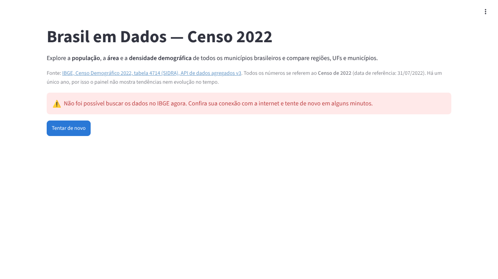
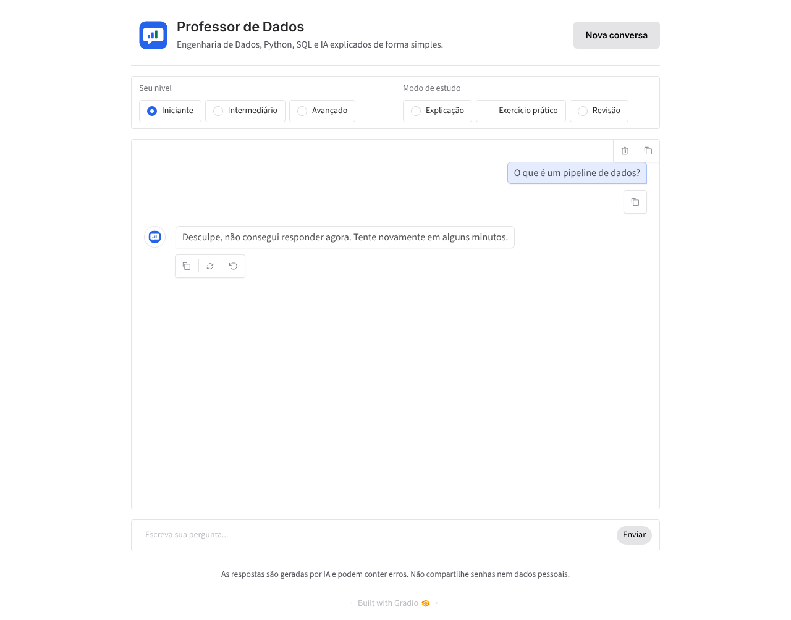
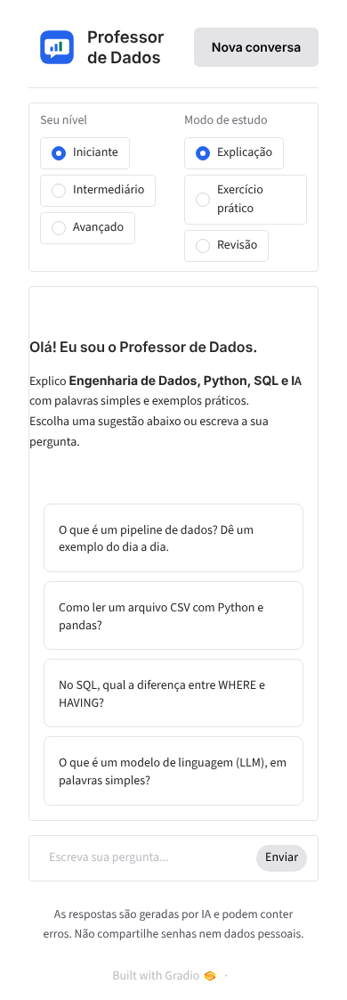
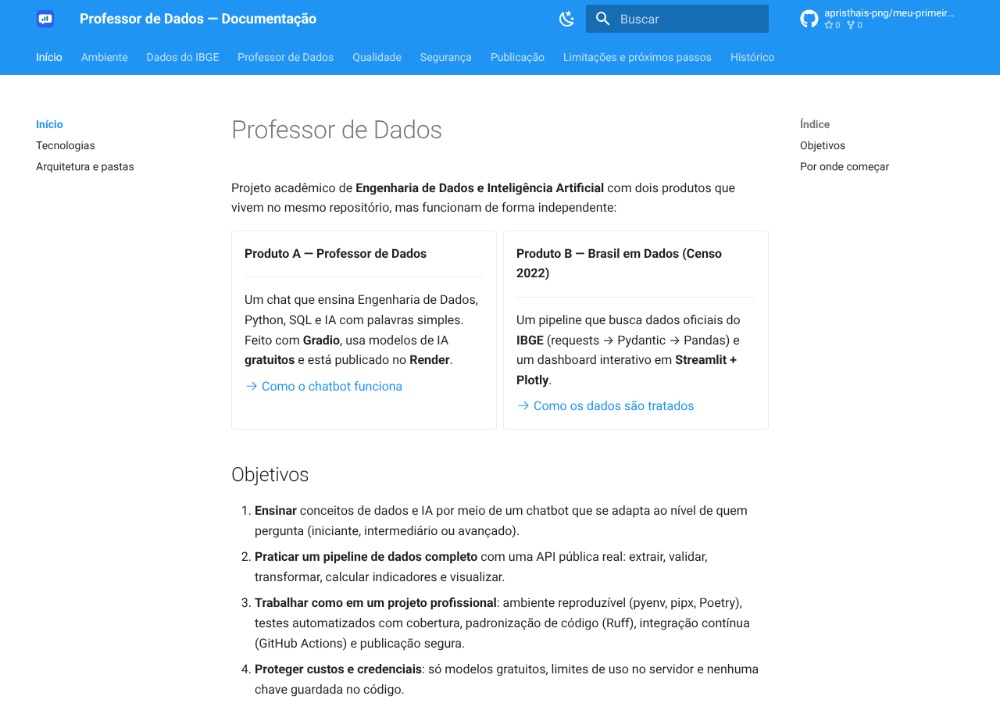

# Evidências

Todos os comandos abaixo foram executados em **21/10/2026** sobre a `main`
(`7c76658`). Os caminhos temporários do ambiente de teste aparecem como
`<ambiente-de-teste>` nos logs.

## Execuções no GitHub Actions (com internet)

| Workflow | O que conferiu | Resultado |
|---|---|---|
| [Validação real da API do IBGE](https://github.com/apristhais-png/meu-primeiro-assistente-ia/actions/runs/39612187252) | Pipeline com a API real + dashboard com dados reais + fotos | ✅ |
| [Ambiente Python (Poetry e Render)](https://github.com/apristhais-png/meu-primeiro-assistente-ia/actions/runs/39612193543) | Poetry do zero com todos os testes; instalação igual à do Render com o chatbot respondendo | ✅ |
| [Documentação (MkDocs)](https://github.com/apristhais-png/meu-primeiro-assistente-ia/actions/runs/39612198695) | `mkdocs build --strict` e site como artefato | ✅ |
| [CI e publicação](https://github.com/apristhais-png/meu-primeiro-assistente-ia/actions/runs/39478943538) | Job `testar` na `main` depois do merge do PR #11 (condição para o Render publicar) | ✅ |

As fotos do dashboard com os dados reais ficam no artefato
[`fotos-dashboard`](https://github.com/apristhais-png/meu-primeiro-assistente-ia/actions/runs/39612187252/artifacts/12350622715)
até 28/10/2026.

## 1. Pipeline com a API real do IBGE

Log: [`logs/ci-api-ibge-pipeline.txt`](logs/ci-api-ibge-pipeline.txt)

```text
INFO pipeline.extracao: ibge_get status=200 duracao_ms=3140 tamanho=2084216
[OK] Qualidade: 5570 de 5570 municípios válidos
[OK] Unidades informadas pela API: {'populacao': 'Pessoas', 'area_km2': 'Quilômetros quadrados',
     'densidade_hab_km2': 'Habitante por quilômetro quadrado'}
[OK] Densidades que não batem com população ÷ área: 0
Indicadores (Brasil):
  População total da seleção: 203.080.756 pessoas
  Maior população: 11.451.999 pessoas — São Paulo (SP)
  Densidade demográfica da seleção: 23,90 hab/km²
População por região:
  Sudeste: 84.840.113 pessoas em 1668 municípios
  ...
CSV salvo em dados/municipios.csv
```

Sem internet (aqui), o mesmo comando para com uma mensagem clara e código 1
([`logs/pipeline-sem-internet.txt`](logs/pipeline-sem-internet.txt)):

```text
[ERRO] não foi possível conectar à API do IBGE (sem internet?)
```

## 2. Dashboard

Com os dados reais (GitHub):

```text
[OK] Brasil em Dados — Censo 2022
  População total: 203.080.756 pessoas
  Municípios: 5.570
  Município mais populoso: São Paulo (SP) (11.451.999 pessoas)
[OK] gráficos: 3; botões de download: 1
[OK] filtro Sudeste + SP: 645 municípios, 44.411.238 pessoas
[OK] foto computador: largura da página 1280px (tela de 1280px)
[OK] foto celular: largura da página 390px (tela de 390px)
```

Aqui, sem internet: o servidor subiu (`/_stcore/health` = `ok`) e a tela
mostrou o estado de erro amigável:



## 3. Professor de Dados (instalado como no Render)

Log: [`logs/render-install.txt`](logs/render-install.txt) e
[`logs/chatbot-execucao.txt`](logs/chatbot-execucao.txt)

```text
$ pip install -r requirements.txt   (buildCommand do render.yaml)
$ pip check
No broken requirements found.
{'gradio': True, 'streamlit': False, 'plotly': False, 'mkdocs': False, 'pytest': False}
HTTP 200 após 9s
INFO app: Abrindo o app em 0.0.0.0:7870
INFO assistente.chat: pergunta_inicio id=ef976daf nivel=iniciante modo=exercicio
INFO assistente.limites: Pergunta liberada | pessoa=não identificada | itens_x_forwarded_for=0
INFO assistente.chat: pergunta_fim id=ef976daf resultado=falha:sem_provedor provedor=- total_ms=2
```

Sem nenhuma chave configurada (regra do projeto neste ambiente), a pergunta
chegou ao servidor com o nível e o modo escolhidos, passou pelo limite de uso e
a pessoa recebeu a mensagem amigável, sem detalhes técnicos:




No celular (390 px), sem rolagem horizontal:

{ width="320" }

## 4. Ambiente

```text
$ pyenv --version            → pyenv 2.8.10
$ cat .python-version        → 3.11
$ pyenv version              → 3.11.17 (set by .../.python-version)
$ pipx --version             → 1.18.4
$ pipx install poetry==2.5.1 → done!
$ poetry check --lock        → All set!
$ poetry install --with dados,dev,docs → Package operations: 98 installs
$ poetry run pytest ...      → 690 passed; 98.32%
```

Logs: [`logs/pyenv.txt`](logs/pyenv.txt), [`logs/poetry.txt`](logs/poetry.txt),
[`logs/pip-check.txt`](logs/pip-check.txt), [`logs/versoes.txt`](logs/versoes.txt).

## 5. Qualidade e documentação

```text
$ ruff check .            → All checks passed!
$ ruff format --check .   → 69 files already formatted
$ python scripts/validar_config.py → [OK] config.yml está correto.
$ python scripts/verificar_segredos.py → [OK] Nenhuma chave encontrada em 92 arquivos.
$ mkdocs build --strict   → Documentation built in 1.33 seconds (sem avisos)
```

Logs: [`logs/ruff.txt`](logs/ruff.txt), [`logs/config.txt`](logs/config.txt),
[`logs/segredos.txt`](logs/segredos.txt), [`logs/mkdocs.txt`](logs/mkdocs.txt).



## 6. Testes, cobertura e segurança

Ver [Testes e cobertura](testes-e-cobertura.md) e
[Auditoria de segurança](auditoria-seguranca.md).
