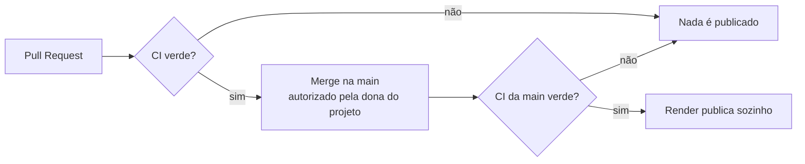
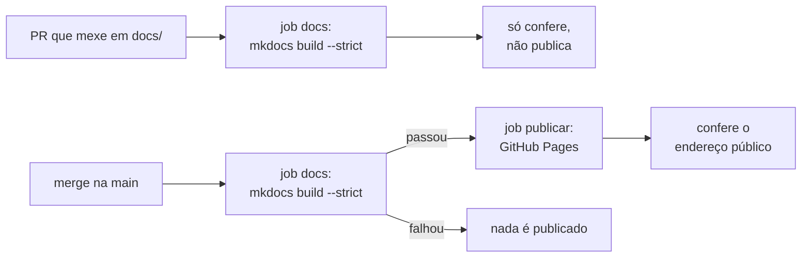

# Como publicar

## Professor de Dados no Render (em produção)

O chatbot está publicado no **Render, plano gratuito**, com a configuração do
`render.yaml`:

| Item | Valor |
|---|---|
| Tipo | Web service, plano `free` |
| Branch | `main` |
| Instalação | `pip install -r requirements.txt` |
| Início | `python app.py` (escuta em `0.0.0.0`, na porta `PORT`) |
| Python | 3.11 (arquivo `.python-version`) |
| Chaves | aba *Environment* (no `render.yaml` aparecem sem valor, `sync: false`) |

### Fluxo de publicação

1. Toda mudança chega por um **Pull Request**, testado pelo GitHub Actions.
2. O merge na `main` só acontece com autorização.
3. O Render publica a `main` **só depois** que as verificações passam (opção
   *After CI Checks Pass*).

!!! warning "Plano gratuito"
    O serviço "dorme" depois de 15 minutos sem acesso; a primeira visita
    depois disso demora mais para abrir. O passo a passo completo (criar o
    serviço, cadastrar as chaves, conferir o primeiro deploy, ler os logs) está
    no [guia de publicação](https://github.com/apristhais-png/meu-primeiro-assistente-ia/blob/main/GUIA-publicacao.md).

!!! note "Merges que não mexem no chatbot"
    O Render não separa pastas: qualquer merge na `main` (inclusive só de
    documentação ou do dashboard) faz uma nova publicação do chatbot, com o
    mesmo código. Isso não muda nada para quem usa.

## Esta documentação (GitHub Pages)

Endereço: **<https://apristhais-png.github.io/meu-primeiro-assistente-ia/>**
(o mesmo `site_url` do `mkdocs.yml`). A publicação é gratuita e automática,
pelo workflow `docs.yml`:

| Regra | Como é garantida |
|---|---|
| Publicar só a partir da `main` | O job `publicar` só roda em push (ou *Run workflow*) na `main`; o ambiente `github-pages` também só aceita a branch padrão |
| Nada quebrado vai para o ar | `publicar` depende do job `docs`, que roda `mkdocs build --strict` |
| Permissões mínimas | O job `docs` só lê o repositório; `pages: write` e `id-token: write` existem só no job `publicar` |
| Sem chaves manuais | O GitHub Pages usa o token automático do Actions (OIDC); nenhum segredo no repositório |
| Uma publicação por vez | `concurrency: github-pages`, sem cancelar uma publicação em andamento |
| O site abriu de verdade | Depois de publicar, o job abre o endereço público e confere as páginas principais (início, API, transformação, dashboard, Professor de Dados, testes e entrega final) |

Ações oficiais usadas: `actions/configure-pages`, `actions/upload-pages-artifact`
e `actions/deploy-pages`.

### Configuração única (dona do repositório)

Antes da primeira publicação: **Settings → Pages → Build and deployment →
Source: GitHub Actions**. O token automático do Actions não tem permissão
para ligar o GitHub Pages sozinho; sem esse passo, o job `publicar` falha
(com a mensagem de que o Pages não está ativado) e nada vai para o ar.

### Relação com o chatbot

- O workflow da documentação só instala o `requirements-docs.txt`; não usa
  o `requirements.txt`, as chaves de IA nem o `render.yaml`.
- Ele roda na `main` **só quando a documentação muda**. Nesses merges, o
  Render espera também este workflow terminar antes de republicar o chatbot
  (opção *After CI Checks Pass*); se a documentação falhar, o chatbot continua
  no ar com a versão anterior, que tem o mesmo código.

## Dashboard — ainda não publicado

O dashboard roda no computador (`streamlit run dashboard/app.py`). A
publicação depende de uma decisão, porque seria um **serviço novo**. Opções
gratuitas conhecidas (confira as condições atuais no site de cada uma antes
de decidir):

| Opção | Pontos a considerar |
|---|---|
| Streamlit Community Cloud | Feito para apps Streamlit; o app dorme sem uso; precisaria de um arquivo de dependências próprio do dashboard, porque o `requirements.txt` da raiz é do chatbot. |
| Segundo serviço gratuito no Render | Mesmo painel do chatbot; também dorme sem uso; as horas gratuitas do mês são da conta, então os dois serviços dividiriam esse limite. |

Nenhuma dessas opções foi ativada.
