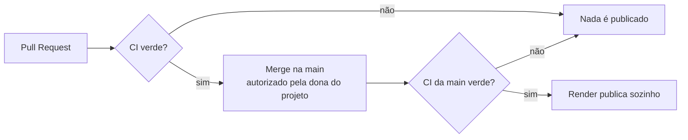

# Como publicar

## Professor de Dados no Render (em produção)

O chatbot está publicado no **Render, plano gratuito**, com a configuração do
`render.yaml`:

| Item | Valor |
|---|---|
| Tipo | Web service, plano `free` |
| Branch | `main` |
| Instalação | `pip install -r requirements.txt` |
| Início | `python app.py` (escuta em `0.0.0.0`, na porta `PORT`) |
| Python | 3.11 (arquivo `.python-version`) |
| Chaves | aba *Environment* (no `render.yaml` aparecem sem valor, `sync: false`) |

### Fluxo de publicação

1. Toda mudança chega por um **Pull Request**, testado pelo GitHub Actions.
2. O merge na `main` só acontece com autorização.
3. O Render publica a `main` **só depois** que as verificações passam (opção
   *After CI Checks Pass*).

!!! warning "Plano gratuito"
    O serviço "dorme" depois de 15 minutos sem acesso; a primeira visita
    depois disso demora mais para abrir. O passo a passo completo (criar o
    serviço, cadastrar as chaves, conferir o primeiro deploy, ler os logs) está
    no [guia de publicação](https://github.com/apristhais-png/meu-primeiro-assistente-ia/blob/main/GUIA-publicacao.md).

!!! note "Merges que não mexem no chatbot"
    O Render não separa pastas: qualquer merge na `main` (inclusive só de
    documentação ou do dashboard) faz uma nova publicação do chatbot, com o
    mesmo código. Isso não muda nada para quem usa.

## Esta documentação (GitHub Pages) — não ativada

O site é **gerado e conferido** em todo Pull Request que mexe na documentação
(workflow `docs.yml`, artefato `site-documentacao`), mas **não é publicado**.
A publicação no GitHub Pages é gratuita para repositórios públicos e depende
de uma autorização da dona do projeto, porque exige uma configuração no
repositório.

Quando for autorizado, os passos são:

1. No GitHub: **Settings → Pages → Build and deployment → Source: GitHub
   Actions** (ação da dona do repositório).
2. Acrescentar ao workflow da documentação um job de publicação, que roda só
   em push na `main`, com as permissões `pages: write` e `id-token: write`,
   usando as ações oficiais `actions/upload-pages-artifact` e
   `actions/deploy-pages`.
3. O endereço será `https://apristhais-png.github.io/meu-primeiro-assistente-ia/`
   (já configurado como `site_url` no `mkdocs.yml`).

Até lá, dá para ver o site no computador (`mkdocs serve`) ou baixar o
artefato da CI e abrir o `index.html`.

## Dashboard — ainda não publicado

O dashboard roda no computador (`streamlit run dashboard/app.py`). A
publicação depende de uma decisão, porque seria um **serviço novo**. Opções
gratuitas conhecidas (confira as condições atuais no site de cada uma antes
de decidir):

| Opção | Pontos a considerar |
|---|---|
| Streamlit Community Cloud | Feito para apps Streamlit; o app dorme sem uso; precisaria de um arquivo de dependências próprio do dashboard, porque o `requirements.txt` da raiz é do chatbot. |
| Segundo serviço gratuito no Render | Mesmo painel do chatbot; também dorme sem uso; as horas gratuitas do mês são da conta, então os dois serviços dividiriam esse limite. |

Nenhuma dessas opções foi ativada.
